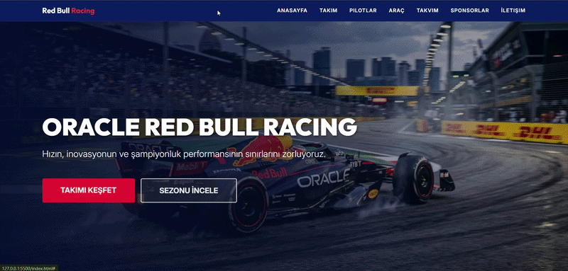

# 🏎️ Oracle Red Bull Racing

A modern, responsive Formula 1 team landing page inspired by Oracle Red Bull Racing. This project showcases the team's drivers, car specifications, racing statistics, race calendar, sponsors, frequently asked questions, and contact form.

--- 

## ✨ Features

- **Responsive Navigation Bar** — Bootstrap navbar with a collapsible mobile menu.
- **Hero Section** — Full-screen banner with background image, overlay, and call-to-action buttons.
- **Team Statistics** — Cards displaying championship and racing statistics.
- **Driver Profiles** — Dedicated cards for Max Verstappen and Sergio Perez.
- **Car Specifications** — RB20 information and technical specifications.
- **Race Calendar** — Responsive table showing Grand Prix events, countries, circuits, and dates.
- **Why Red Bull Racing?** — Feature cards highlighting innovation, championship history, and engineering.
- **Sponsors Section** — Sponsor names with grayscale and hover effects.
- **FAQ Accordion** — Expandable questions and answers powered by Bootstrap.
- **Contact Form** — Form layout with name, email, subject, and message fields.
- **Footer** — Navigation links and social media icons.
- **Custom CSS Styling** — CSS variables, gradients, transitions, shadows, and hover animations.
- **Responsive Design** — Bootstrap grid system and responsive utility classes.
- **Google Fonts** — Inter and Outfit typography.
- **Bootstrap Icons** — Icons for locations, features, and social media.

---

## 🛠️ Technologies Used

| Technology | Purpose |
|---|---|
| HTML5 | Structuring the webpage |
| CSS3 | Custom styling and visual effects |
| Bootstrap 5.3.8 | Responsive layout and UI components |
| Bootstrap Icons 1.13.1 | Interface icons |
| JavaScript (Bootstrap Bundle) | Navbar toggle and FAQ accordion behavior |
| Google Fonts | Inter and Outfit typography |
| CSS Variables | Centralized color management |
| CSS Flexbox | Flexible alignment and layout |
| CSS Grid / Bootstrap Grid | Responsive content layout |
| CSS Transitions & Transforms | Hover animations and visual interactions |

---

## 🔍 Preview

---

## 📞 Contact  

📩 **Email:** [saadetnajaf@gmail.com](mailto:saadetnajaf@gmail.com)  
📷 **Instagram:** [@saadet_najaf](https://www.instagram.com/saadet_najaf)  
💼 **LinkedIn:** [Saadet Najaf](https://www.linkedin.com/in/saadetnajaf/)
